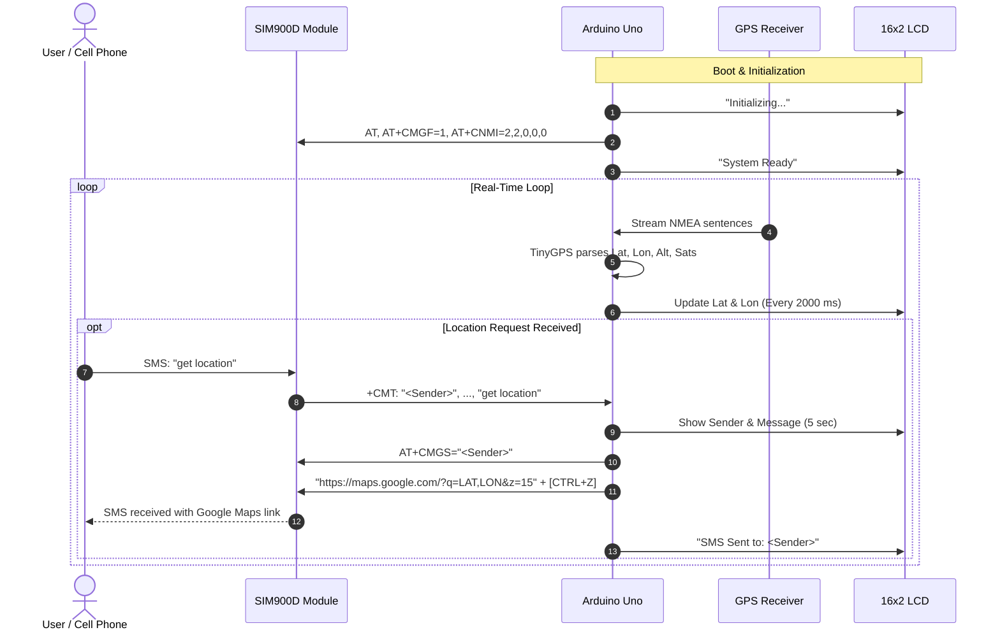

# 🛰️ GPS & GSM Real-Time Tracking System (Proteus Simulation)

[-blue.svg)](https://www.arduino.cc/)
[](https://www.labcenter.com/)
[-00979D.svg)](https://www.arduino.cc/)
[](#license)

An end-to-end embedded systems project implementing a **Real-Time GPS Tracker and GSM Notification System** based on the **ATmega328P (Arduino Uno)** microcontroller.

The entire circuit, peripheral interfacing, and sensor telemetry are **fully modeled, simulated, and tested in Proteus Design Suite 8**, providing complete hardware-free verification for GPS coordinate parsing, bidirectional SMS telematics, LCD telemetry display, and serial terminal diagnostics.

---

## 📑 Table of Contents

- [Overview](#-overview)
- [System Architecture](#-system-architecture)
- [Key Features](#-key-features)
- [Hardware & Simulation Components](#-hardware--simulation-components)
- [Pinout & Interfacing Diagram](#-pinout--interfacing-diagram)
- [Software Architecture & Firmware Logic](#-software-architecture--firmware-logic)
- [Proteus Simulation Guide](#-proteus-simulation-guide)
  - [Prerequisites](#prerequisites)
  - [Compiling and Exporting the HEX File](#compiling-and-exporting-the-hex-file)
  - [Configuring the Proteus Schematic](#configuring-the-proteus-schematic)
  - [Running the Simulation](#running-the-simulation)
  - [Testing Scenarios](#testing-scenarios)
- [CLI Terminal Commands](#-cli-terminal-commands)
- [GSM AT Command Protocol](#-gsm-at-command-protocol)
- [Project Directory Structure](#-project-directory-structure)
- [Real-World Hardware Deployment Notes](#-real-world-hardware-deployment-notes)
- [License & Acknowledgments](#-license--acknowledgments)

---

## 📌 Overview

This project provides an automated asset/vehicle tracking solution. The microcontroller continuously captures NMEA satellite sentences from a GPS module, extracts geographic positioning data (Latitude, Longitude, Altitude, Satellites count), and displays current coordinates on a 16×2 character LCD.

Simultaneously, the system interfaces with a **SIM900D GSM Module** to handle remote SMS telematics:
1. **On-Demand Location Queries:** If a user sends an SMS containing `"location"` or `"get location"`, the system processes the request and responds with an SMS containing an instant **clickable Google Maps URL** with the exact coordinates.
2. **Live Display Notifications:** Incoming SMS messages and sender numbers are displayed on the LCD.
3. **Interactive Control Console:** A Virtual Terminal console connects to the hardware UART port, enabling real-time diagnostics, manual SMS dispatch, inbox review, and configuration toggling.

---

## 🏗️ System Architecture

```mermaid
flowchart TD
    subgraph Proteus Simulation Environment
        GPS["🛰️ GPS Module\n(NMEA TX @ 9600 bps)"] -->|Pin 5 (GPS_RX)| ARD["🧠 Arduino Uno\n(ATmega328P)"]
        ARD -->|Pin 4 (GPS_TX)| GPS

        GSM["📶 GSM Module\n(SIM900D @ 9600 bps)"] <-->|Pins 2 & 3\n(SoftwareSerial)| ARD

        ARD -->|Pins 7-12\n(4-Bit Mode)| LCD["🖥️ 16x2 LCD Display\n(LM016L)"]
        POT["⚙️ Trimpot 5kΩ"] -->|VEE / V0| LCD

        TERM["💻 Virtual Terminal\n(Debug Console)"] <-->|Pins 0 & 1\n(Hardware UART)| ARD
    end

    subgraph Remote Interaction
        USER["📱 Remote Phone / User"] <-->|SMS Messages / Location Request| GSM
    end
```

---

## ✨ Key Features

- **Real-Time GPS Parsing:** Utilizes the lightweight `TinyGPS` library to decode standard NMEA sentences (`$GPGGA`, `$GPRMC`) into floating-point coordinates, altitude, and satellite fix metrics.
- **SMS Location Dispatch:** Automatically formats and sends an SMS containing a direct Google Maps link:
  ```text
  https://maps.google.com/?q=LATITUDE,LONGITUDE&z=15
  ```
- **Bidirectional GSM Telematics:** Supports text-mode AT commands (`AT+CMGF=1`), unsolicited incoming message alerts (`AT+CNMI`), inbox reading (`AT+CMGL="ALL"`), and direct SMS sending (`AT+CMGS`).
- **Dynamic 16×2 LCD Updates:**
  - Standard Mode: Shows real-time Latitude and Longitude refreshed every 2 seconds.
  - Alert Mode: Displays sender phone number and message preview for 5 seconds when an SMS arrives.
- **Interactive Serial Diagnostic CLI:** Real-time command-line prompt for debugging, manual coordinate querying, and modem configuration.
- **Proteus Virtual Simulation Ready:** Comes with an assembled `.pdsprj` schematic for instant execution without physical components.

---

## 🔌 Hardware & Simulation Components

| Component | Proteus Device Name | Description / Role |
| :--- | :--- | :--- |
| **Microcontroller** | `ARDUINO UNO` / `ATMEGA328P` | Core embedded controller running the firmware logic |
| **GPS Receiver** | `GPS Module` / `NMEA Generator` | Generates serial NMEA sentences with geographic coordinates |
| **Cellular Modem** | `GSM Module Sim900D` | Handles wireless SMS communication and cellular AT commands |
| **Alphanumeric Display** | `LM016L` (HD44780 compatible) | 16-character by 2-line LCD display |
| **Contrast Trimpot** | `POT-HG` / `5.0K` | Adjusts LCD contrast pin ($V_{EE} / V_0$) |
| **Serial Monitors** | `VIRTUAL TERMINAL` | Monitors hardware UART (CLI) and GSM/GPS data streams |

---

## 🗺️ Pinout & Interfacing Diagram

### 1. Arduino Uno to GPS Module
| Arduino Pin | GPS Pin | Function | Notes |
| :--- | :--- | :--- | :--- |
| **Pin 5** | `TX` | `GPS_RX` (SoftwareSerial) | Receives NMEA data stream into Arduino |
| **Pin 4** | `RX` | `GPS_TX` (SoftwareSerial) | Transmits commands to GPS (optional) |
| **5V** | `VCC` | Power | System +5V supply |
| **GND** | `GND` | Ground | Common reference ground |

### 2. Arduino Uno to GSM Module (SIM900D)
| Arduino Pin | GSM Pin | Function | Notes |
| :--- | :--- | :--- | :--- |
| **Pin 3** | `TXD` | `GSM_RX` (SoftwareSerial) | Receives AT responses & incoming SMS |
| **Pin 2** | `RXD` | `GSM_TX` (SoftwareSerial) | Sends AT commands & SMS messages |
| **GND** | `GND` | Ground | Common reference ground |

### 3. Arduino Uno to 16×2 LCD Display (`LM016L`)
| LCD Pin | Pin Name | Connected To | Notes |
| :--- | :--- | :--- | :--- |
| **1** | `VSS` | `GND` | Power Ground |
| **2** | `VDD` | `+5V` | Power Supply (+5V) |
| **3** | `VEE / V0`| Potentiometer Wiper | Contrast Adjustment (0 to 5V) |
| **4** | `RS` | **Arduino Pin 7** | Register Select (Command / Data) |
| **5** | `RW` | `GND` | Read/Write (GND = Write Mode) |
| **6** | `E` | **Arduino Pin 8** | Enable Signal |
| **11** | `D4` | **Arduino Pin 9** | Data Bit 4 |
| **12** | `D5` | **Arduino Pin 10** | Data Bit 5 |
| **13** | `D6` | **Arduino Pin 11** | Data Bit 6 |
| **14** | `D7` | **Arduino Pin 12** | Data Bit 7 |

### 4. Arduino Uno to Virtual Terminal (Hardware Serial)
| Arduino Pin | Terminal Pin | Description |
| :--- | :--- | :--- |
| **Pin 0 (RX)** | `TX` of Virtual Terminal | Receives commands typed into the terminal |
| **Pin 1 (TX)** | `RX` of Virtual Terminal | Sends diagnostic messages and CLI responses to terminal |

---

## 💻 Software Architecture & Firmware Logic

### Firmware Execution Pipeline



### Required Arduino Libraries
- **`TinyGPS`** (by Mikal Hart) — Efficient NMEA parsing.
- **`SoftwareSerial`** (Built-in) — Software UART emulation for multi-port serial communications.
- **`LiquidCrystal`** (Built-in) — Driver for HD44780 LCD display in 4-bit bus mode.

---

## 🧪 Proteus Simulation Guide

### Prerequisites
1. **Proteus Design Suite 8.x** (or later) installed on your machine.
2. **Arduino IDE 1.8.x or 2.x**.
3. Proteus Arduino and GPS/GSM simulation library installed in your Proteus `LIBRARY/` path if not already present.

---

### Compiling and Exporting the HEX File

Proteus requires the compiled machine code (`.hex`) to simulate the Arduino Uno (ATmega328P).

1. Open `GPS_Tracker/GPS_Tracker.ino` in the **Arduino IDE**.
2. Go to **Tools** -> **Board** -> select **Arduino Uno**.
3. Install the **TinyGPS** library if not already installed:
   - Go to **Sketch** -> **Include Library** -> **Manage Libraries...**
   - Search for `TinyGPS` by Mikal Hart and click **Install**.
4. Export the compiled binary:
   - Go to **Sketch** -> **Export Compiled Binary** (or press `Ctrl + Alt + S`).
5. A `.hex` file will be generated inside the project folder (`GPS_Tracker/build/...` or directly in `GPS_Tracker/GPS_Tracker.ino.hex` / `GPS_Tracker.ino.with_bootloader.hex`).

---

### Configuring the Proteus Schematic

1. Launch **Proteus Design Suite**.
2. Click **File** -> **Open Project...** and select [GPS Tracker.pdsprj](file:///d:/Yassin%20Bassam/Projects/Embedded%20Systems%20Project/GPS%20Tracker/GPS%20Tracker.pdsprj).
3. **Load Firmware to the Arduino:**
   - Double-click on the **Arduino Uno** module in the schematic to open the **Edit Component** window.
   - Locate the **Program File** field.
   - Click the folder icon 📁 and browse to select the compiled `GPS_Tracker.ino.hex` file.
   - Ensure the Clock Frequency is set to **16MHz**.
   - Click **OK**.
4. **Configure GPS Module (if using NMEA file or Virtual Terminal):**
   - Ensure the baud rate is set to **9600**.
   - If using a Proteus GPS model that reads a mock NMEA file, specify your coordinates or test NMEA file.
5. **Configure GSM Module / Virtual Terminal:**
   - Ensure the baud rate of the Virtual Terminals is set to **9600**, **8 Data Bits**, **No Parity**, **1 Stop Bit**.

---

### Running the Simulation

1. Click the **Play / Run Simulation** button (▶) in the bottom-left corner of Proteus.
2. Watch the **16x2 LCD Display**:
   - `Initializing...` appears during GSM handshake (`AT`, `AT+CMGF=1`, `AT+CNMI=2,2,0,0,0`).
   - `System Ready` displays briefly.
   - The screen will transition to cyclic coordinate telemetry:
     ```text
     Lat:30.9000
     Lon:33.7000
     ```
3. Open the **Virtual Terminal** window (if it does not pop up automatically, go to the top menu: **Debug** -> **Virtual Terminal**).

---

### Testing Scenarios

#### Scenario 1: Interacting via Serial CLI
In the Arduino Virtual Terminal window, type commands and press `Enter`:
- Type `gps` and press `Enter`:
  ```text
  === GPS DATA ===
  Latitude: 30.900000
  Longitude: 33.700000
  Satellites: 8
  Altitude: 156.20 m
  ================
  ```
- Type `help` to view all available commands.

#### Scenario 2: Requesting Location via Simulated SMS
1. Using the GSM terminal or simulated GSM sender, transmit an incoming SMS notification in GSM standard format:
   ```text
   +CMT: "+201001234567","","26/10/09,12:00:00+08"
   get location
   ```
2. **System Response:**
   - The LCD switches to show:
     ```text
     From: 01001234567
     get location
     ```
   - The Arduino triggers `sendLocationSMS("+201001234567")`.
   - The GSM terminal receives:
     ```text
     AT+CMGS="+201001234567"
     https://maps.google.com/?q=30.900000,33.700000&z=15
     ```
   - The LCD updates to:
     ```text
     SMS Sent to:
     +201001234567
     ```

#### Scenario 3: Manual SMS Dispatch from CLI
Type in the Virtual Terminal:
```bash
sms +201099887766 Vehicle ignition triggered!
```
The Arduino executes the AT command sequence to transmit the SMS to the target number.

---

## 🖥️ CLI Terminal Commands

The system features a built-in interactive command interpreter accessible via Hardware Serial (9600 Baud):

| Command | Syntax | Description | Example Output |
| :--- | :--- | :--- | :--- |
| `gps` | `gps` | Displays latitude, longitude, altitude, and satellite count | `Latitude: 30.900000, Longitude: 33.700000...` |
| `sms` | `sms <number> <message>` | Sends an SMS message to the specified phone number | `SMS sent to +201234567890` |
| `inbox` | `inbox` | Fetches and displays all messages stored on the SIM card | `--- SMS Message --- From: ...` |
| `notify on` | `notify on` | Enables automatic SMS alert reception (`AT+CNMI=2,2,0,0,0`) | `SMS notifications enabled` |
| `notify off`| `notify off`| Disables automatic SMS alerts (`AT+CNMI=0,0,0,0,0`) | `SMS notifications disabled` |
| `help` | `help` | Prints the available command manual | `=== GPS-GSM SYSTEM === ...` |

---

## 📡 GSM AT Command Protocol

The firmware communicates with the SIM900D modem using standard Hayes AT commands:

```text
1. AT
   --> Check modem responsiveness (expect "OK")

2. AT+CMGF=1
   --> Set SMS mode to Text Mode (ASCII) instead of PDU mode

3. AT+CNMI=2,2,0,0,0
   --> Configure modem to forward new incoming SMS directly to serial (+CMT)

4. AT+CMGS="<PHONE_NUMBER>"
   --> Initiate SMS transmission
   --> Wait for prompt '>'
   --> Write SMS payload
   --> Transmit ASCII 26 (CTRL+Z / 0x1A) to send message

5. AT+CMGL="ALL"
   --> List all received SMS messages stored on the SIM card
```

---

## 📂 Project Directory Structure

```text
GPS Tracker/
├── GPS Tracker.pdsprj           # Proteus Design Suite 8 schematic & simulation project
├── GPS Tracker.pdsprj.workspace # Proteus workspace layout & user window preferences
├── GPS_Tracker/
│   └── GPS_Tracker.ino         # Arduino C++ source code (Firmware)
└── README.md                   # Project documentation & simulation guide
```

---

## ⚡ Real-World Hardware Deployment Notes

If you transition this project from **Proteus Simulation** to **Physical Hardware**, keep the following key hardware considerations in mind:

1. **Power Supply Requirements for SIM900/SIM800:**
   - GSM modules require a power supply capable of supplying up to **2.0A peak current bursts** during RF transmission.
   - Do **NOT** power the GSM module directly from the Arduino 5V/3.3V pin. Use an external regulated $5\text{V}$ (or $4.0\text{V} - 4.2\text{V}$) power supply with a common ground.
2. **Logic Level Shifting:**
   - The Arduino Uno operates at $5\text{V}$ logic levels.
   - Many GPS modules (e.g., NEO-6M) and GSM modules (e.g., SIM800L/SIM900) use $3.3\text{V}$ UART logic.
   - Use a simple resistor divider ($1\text{k}\Omega : 2\text{k}\Omega$) on the Arduino `TX` -> Module `RX` line to protect $3.3\text{V}$ inputs.
3. **Antenna Placement:**
   - GPS receivers require direct line-of-sight to the sky for cold/warm satellite fix. Testing indoors without an active external antenna placed near a window will yield no fix (`satellites = 0`).

---

## 📜 License & Acknowledgments

- **Firmware Author:** Yassin Bassam
- **Libraries Used:**
  - [TinyGPS](https://github.com/mikalhart/TinyGPS) by Mikal Hart
  - [Arduino Core Libraries](https://github.com/arduino/ArduinoCore-avr)
- **License:** Open-source project for educational and embedded systems engineering purposes.
